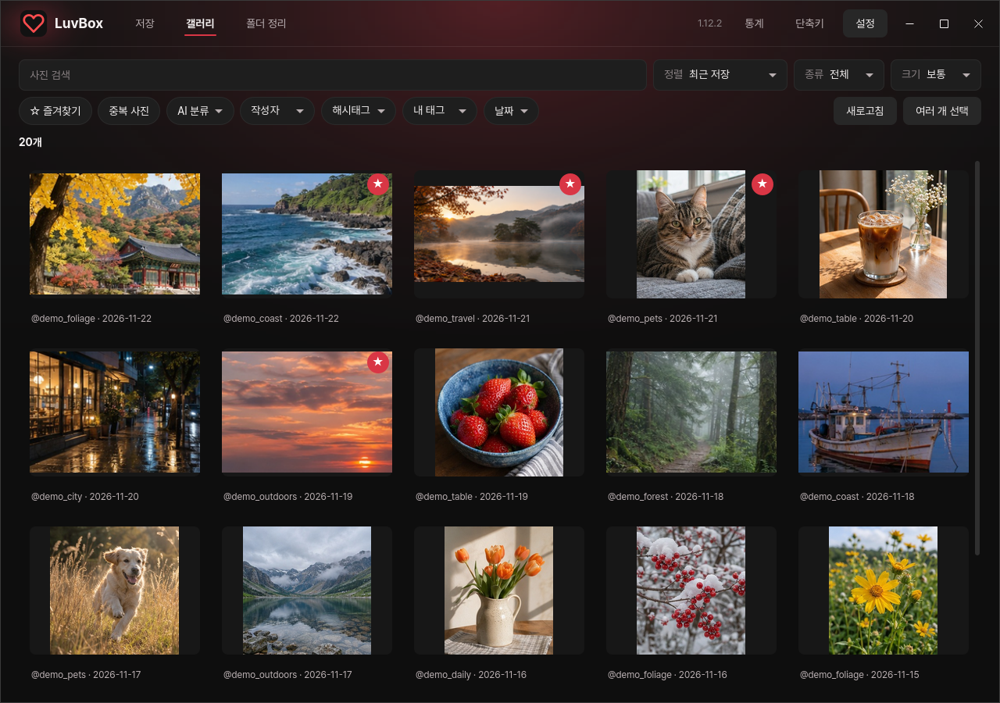
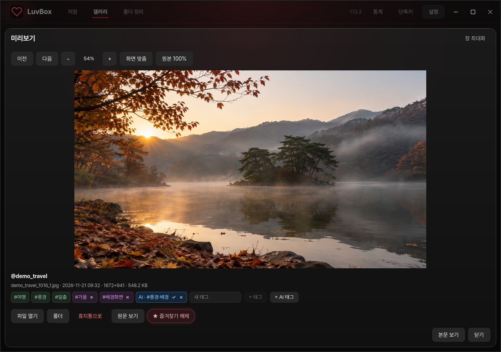

# 러브박스 (LuvBox) 1.11.7

**X(트위터)에서 좋아요한 사진·영상·GIF를 내 PC에 저장하고, 갤러리로 모아 보는 Windows 앱입니다.**

마음에 드는 게시물에 좋아요만 눌러 두세요. 사진·영상은 LuvBox가 내 폴더에 모아 두고, 갤러리에서 다시 찾아보기 쉽게 정리해 줍니다.

## 받기

**[최신 버전 받기](https://github.com/white-critter/LuvBox/releases/latest)** — 열린 페이지 아래쪽 **Assets**에서 `LuvBox.exe` 하나만 받으면 됩니다.

- 설치 과정이 없습니다. 받은 파일을 원하는 폴더에 두고 실행하세요.
- Windows 10·11(64비트)에서 동작합니다.
- 처음 실행할 때 Windows가 “PC 보호” 경고를 보이면 **추가 정보 → 실행**을 누르세요. 개인이 만든 앱이라 나오는 안내입니다.

## 쓰는 법

1. **X 연결** — 쓰는 브라우저(Chrome·Edge·Firefox)를 고르고 안내대로 계정을 연결합니다. 처음 한 번은 브라우저에 연결 확장을 설치하며, 앱이 순서대로 알려 줍니다.
2. **저장 시작** — 저장할 폴더를 고르고 누르면 좋아요한 사진·영상·GIF를 받습니다.
3. **갤러리** — 저장한 사진을 검색하고, 걸러 보고, 정리합니다.

창 위쪽 **×**를 누르면 트레이로 숨겨지고 저장은 계속됩니다. LuvBox를 다시 실행하면 숨긴 창이 열립니다. 완전히 종료하려면 작업 표시줄 알림 영역의 LuvBox 아이콘을 오른쪽 클릭하세요.

이런 것도 됩니다.

- 매일 정해진 시각에 자동 저장
- 즐겨찾기, 내 태그, 작성자·해시태그·날짜로 걸러 보기
- 중복 사진 찾아 정리하기 (Windows 휴지통으로 보내므로 되살릴 수 있습니다)
- AI 자동 분류 (일러스트·인물·동물·짤·풍경, 이 PC 안에서만 동작)

  
  

더 자세한 설명은 [사용 안내](docs/사용안내.txt)에 있습니다.

## 업데이트

새 버전이 나오면 앱 위쪽에 알림이 뜹니다. **업데이트**만 누르면 되고, 사진·설정·로그인은 그대로 유지됩니다.
버전마다 달라진 점은 [변경 사항](CHANGELOG.md)에서 볼 수 있습니다.

## 자주 묻는 것

- **로그인 정보는 안전한가요?** 이 PC에만 암호화해 보관하고, X에서 좋아요 목록을 받는 데만 씁니다.
- **사진은 어디에 저장되나요?** 직접 고른 폴더에 저장됩니다. 설정과 기록은 `%LOCALAPPDATA%\LuvBox`에 있습니다.
- **지우려면?** `LuvBox.exe`와 `%LOCALAPPDATA%\LuvBox\app` 폴더를 지우세요. 설정과 기록까지 없애려면 `%LOCALAPPDATA%\LuvBox` 폴더 전체를 지웁니다. 저장한 사진은 지워지지 않습니다.
- **받은 파일이 진짜인지 확인하려면?** 같은 릴리스의 `SHA256-<버전>.txt`에 적힌 값과 받은 `LuvBox.exe`의 SHA-256을 비교하세요.
- **1.7.x 이하의 옛 버전을 쓰고 있다면?** 최신 `LuvBox.exe`를 한 번 직접 받아 주세요. 그다음부터는 앱 안에서 업데이트됩니다.

## 문의·버그 신고

**[여기에 글을 남겨 주세요](https://github.com/white-critter/LuvBox/issues/new/choose)** (GitHub 계정이 필요합니다). 버그, 불편한 점, 바라는 기능 모두 좋습니다.

글은 누구나 볼 수 있으니 로그인 토큰·쿠키 같은 개인 정보는 올리지 마세요.

## 소스 코드와 라이선스

GPL-2.0 라이선스입니다. 소스 코드와 라이선스 고지는 릴리스마다 함께 올리는 `LuvBox-<버전>-source-licenses.zip`에 있습니다.

이 저장소는 배포용이라 외부 Pull Request는 받지 않습니다. 개발 관련 내용은 [개발 안내](docs/development.md)에 있습니다.
