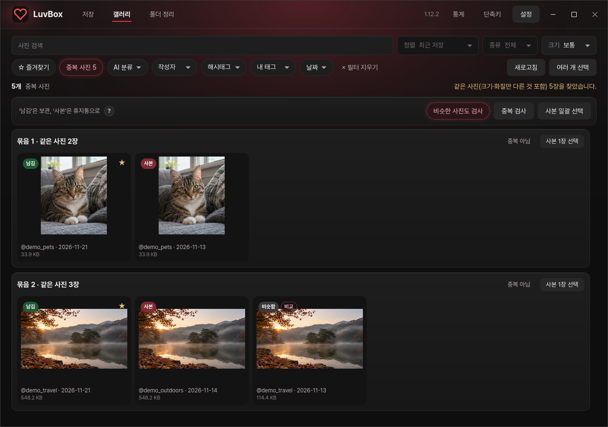

# 러브박스 (LuvBox) 1.12.2

**X에서 좋아요한 사진·영상·GIF를 내 PC에 모아 보세요.** LuvBox는 좋아요한 미디어를 저장하고, 이미 갖고 있는 사진까지 정리할 수 있는 Windows 앱입니다.

**[최신 LuvBox.exe 받기](https://github.com/white-critter/LuvBox/releases/latest/download/LuvBox.exe)** · Windows 10·11 (64비트) · 설치 없이 실행

## 할 수 있는 일

- **X 좋아요 저장** — 사진·영상·GIF를 원하는 폴더에 저장합니다. 매일 정해진 시각에 자동으로 새 좋아요를 확인할 수 있습니다.
- **갤러리에서 다시 찾기** — 저장한 미디어를 크게 미리 보고, 즐겨찾기·태그·작성자·날짜로 걸러 봅니다. **AI 태그 관리**에서 나만의 태그를 만들고 PC 안에서 사진을 자동 분류할 수 있습니다.
- **내 사진 폴더 정리** — PC에 있는 폴더를 열어 태그로 분류하고, 같은 사진과 크기·화질이 다른 사진을 비교합니다. 정리한 사본은 Windows 휴지통에서 되살릴 수 있습니다.

  
  

화면은 예시 계정과 AI로 만든 사진을 사용해 촬영했습니다.

## 시작하기

1. 받은 `LuvBox.exe` 하나를 실행합니다.
2. **X 연결**에서 Chrome·Edge·Firefox 중 X에 로그인한 브라우저를 고릅니다. 연결 확장 설치와 계정 승인은 앱에서 안내합니다.
3. **저장 위치**에서 폴더를 고르고 **저장 시작**을 누릅니다.

PC에 있는 사진은 **폴더 정리** 탭에서 바로 열 수 있습니다.

X 로그인 정보는 이 PC에 암호화해 보관합니다. 새 버전은 앱 상단의 **업데이트** 알림에서 받을 수 있습니다.

[사용 안내](docs/사용안내.txt) · [변경 사항](CHANGELOG.md) · [문의·버그 신고](https://naver.me/5Hyw0RwY)

라이선스는 [GPL-2.0](LICENSE)입니다. 소스 코드와 라이선스 고지는 각 릴리스의 `LuvBox-<버전>-source-licenses.zip`에 포함됩니다. [릴리스 목록](https://github.com/white-critter/LuvBox/releases)
