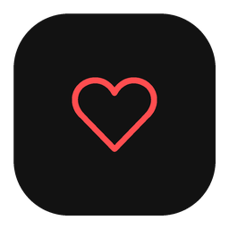

# 러브박스 (LuvBox) 1.0.0



X(트위터)에서 내가 **좋아요(Like)** 누른 게시물의 사진·동영상·GIF를 내 PC 폴더에 모아 두는 Windows 프로그램입니다.

## 할 수 있는 일

- 좋아요한 게시물의 **사진(원본 크기)·동영상(최고 화질)·움직이는 GIF**를 저장합니다.
- 한 번 받은 파일은 건너뛰고, 다음부터는 **새로 누른 좋아요만** 빠르게 받습니다.
- **매일 정한 시각에 자동 저장**할 수 있습니다.
- **저장 전에 하나씩 확인**을 켜면 사진·동영상·GIF를 보고 **저장 / 건너뛰기 / 저장 안 함**을 고릅니다. 저장 중에도 켜고 끌 수 있습니다.
- **기록 · 통계**에서 받은 파일을 목록·갤러리로 보고, 작성자나 게시물 내용으로 찾습니다. 작성자별 순위와 달마다 몇 개를 저장했는지도 봅니다.
- 목록·갤러리에서 선택한 파일을 **Windows 휴지통으로 보내기**로 정리할 수 있습니다. 보낸 파일은 **사라진 파일**에서 확인합니다.
- 탐색기에서 지운 파일은 **사라진 파일**에 모입니다. 작은 미리보기와 원래 위치를 보고, 필요하면 다시 받습니다.
- 저장한 파일 안에 원본 게시물 주소와 작성자를 적어 두어, 나중에도 출처를 알 수 있습니다.
- 라이트·다크 테마를 고를 수 있습니다.

## 설치와 실행

1. [Releases](../../releases)에서 `LuvBox-1.0.0.zip`을 받아 압축을 풉니다.
2. `LuvBox-1.0.0` 폴더 안의 `LuvBox-1.0.0.exe`를 실행합니다.
   - exe는 같은 폴더의 `_internal`과 함께 있어야 합니다. 옮길 때는 **폴더째** 옮기세요.
   - 처음 실행할 때 Windows가 “PC 보호” 창을 띄우면 **추가 정보 → 실행**을 누릅니다.

필요한 것: Windows 10·11(64비트), Microsoft Edge(로그인에 사용). Python 같은 다른 프로그램은 설치하지 않아도 됩니다.

## 사용 방법

1. **내 X 아이디**에 내 아이디를 입력합니다.
2. **로그인 연결 → Edge에서 X 로그인**을 누르고, 열린 Edge 창에서 로그인합니다. 처음 한 번만 하면 됩니다.
3. **저장 폴더**를 고르고 **저장 시작**을 누릅니다.

필요하면 **저장 설정**에서 폴더 정리 방식(한 폴더에 모두·작성자별·저장한 날짜별), 동영상·GIF 저장 여부, 영상 하나의 최대 크기를 바꿉니다. 자세한 안내는 프로그램의 **사용 방법**에 있습니다.

### 매일 자동 저장

메뉴의 **자동 저장**에서 시각을 고르고 **예약 켜기**를 누릅니다. 매일 그 시각에 새 좋아요를 저장하고, PC가 꺼져 있던 날은 다음에 켤 때 저장합니다. ‘Edge에서 X 로그인’으로 연결했을 때 쓸 수 있습니다.

### 보고 골라 저장하기

메인 화면의 **저장 전에 하나씩 확인**을 켜고 **저장 시작**을 누릅니다. 사진은 크게 표시하고 동영상·GIF는 소리 없이 처음 30초를 반복합니다. **저장**, **이번엔 건너뛰기**, **저장 안 함**, **전체 작업 중단**을 고르거나 **이후 자동 저장**으로 확인을 끕니다. 메인 화면의 옵션도 저장 중에 바꿀 수 있습니다. 옵션은 다음 실행에도 기억하며 기본값은 꺼짐입니다.

미리보기를 위해 먼저 저장 폴더에 임시 파일을 내려받습니다. 선택 전에 인터넷 데이터는 사용하며, 동기화 폴더에서는 임시 파일도 동기화될 수 있습니다. **저장**을 고르면 최종 파일로 보관하고 출처·다운로드 기록을 남깁니다. 이미 받은 파일은 확인창 없이 건너뜁니다.

**이번엔 건너뛰기**로 거절한 새 파일은 성공 기록을 남기지 않고 다음 실행에서 다시 확인합니다. 다음 **새 Like만 확인**은 건너뛴 파일이 나올 때까지만 조금 더 확인합니다. **사라진 파일 → 다시 받기**에서 거절한 파일은 다음에 다시 받기로 선택하면 됩니다. 확인창을 닫으면 전체 작업을 중단합니다.

건너뛰기는 이번 실행에만 적용됩니다. 이후 확인 옵션을 끄거나 예약 자동 저장을 실행하면 건너뛴 새 파일도 자동으로 저장될 수 있습니다.

**저장 안 함**을 고른 파일은 다시 묻지 않고, 예약 자동 저장에서도 받지 않습니다. 작은 미리보기만 남겨 두며, 나중에 필요하면 **기록 · 통계 → 사라진 파일**에서 **숨긴 파일도 보기**를 켜고 골라 **다시 받기**를 누릅니다.

예약 자동 저장은 이 옵션과 관계없이 확인창 없이 진행합니다.

### 파일을 지웠을 때

**기록 · 통계**의 목록·갤러리나 **통계**의 작성자 파일에서 파일을 고른 뒤 **휴지통으로 보내기**를 누르거나 우클릭 메뉴·Delete 키를 사용합니다. 확인창에서 파일 개수와 용량을 확인하고 진행하세요. 휴지통을 사용할 수 없는 위치는 건너뜁니다.

기본으로 **이 계정에서 다시 받지 않기**가 켜져 있습니다. 다시 필요하면 **사라진 파일**의 **숨긴 파일도 보기**에서 골라 **다시 받기**를 누릅니다. Windows 휴지통에서 원래 위치로 복원한 뒤 **새로고침**을 누르면 파일이 다시 표시됩니다.

탐색기에서 직접 지운 파일도 **새로고침**을 누르면 **사라진 파일**에 반영됩니다.

- 지운 파일은 자동으로 다시 받지 않습니다. 다시 필요하면 골라서 **다시 받기**를 누릅니다.
- 목록에서 치우려면 **다시 받지 않기**를 누릅니다. **전체 선택**으로 모든 페이지를 한 번에 고를 수 있습니다.
- 파일을 고르면 작은 미리보기, 원래 폴더, 사라진 것을 안 날짜가 보입니다. 이미 있는 파일의 미리보기는 **파일 관리 → 작은 미리보기 저장**으로 미리 만들어 둘 수 있습니다.
- 저장 폴더를 통째로 옮겼거나 외장 드라이브를 뺐다면, 기록 창이 알려 주고 파일을 지운 것으로 처리하지 않습니다. 옮긴 경우 메인 화면의 **저장 폴더**에서 새 위치를 고르세요.

### 여러 계정

계정마다 기록을 따로 둡니다. 여러 계정이 한 저장 폴더를 함께 쓰면 기록 창이 알려 주고, **기록 합치기**로 다른 계정이 받은 파일도 지금 계정에서 함께 관리할 수 있습니다.

## 자주 묻는 질문

**이미 받은 파일을 또 받나요?**
아니요. 한 번 받은 파일은 기억하고 건너뜁니다. 중간에 멈춰도 받은 파일은 그대로 남습니다.

**로그인 정보는 어디에 저장되나요?**
이 PC에만, 지금 Windows 계정만 읽을 수 있게 암호화해 보관합니다. 다른 곳으로 보내지 않습니다.

**저장 폴더를 바꾸고 싶어요.**
메인 화면의 **저장 폴더**에서 새 위치를 고르면 기록도 함께 옮겨집니다. 이미 받은 파일은 원래 자리에 그대로 둡니다.

**다른 PC에서 이어 쓰고 싶어요.**
저장 폴더를 통째로 옮기거나 같은 폴더(동기화 폴더 등)를 고르면, 폴더 안에 있는 기록 사본으로 이어서 씁니다. 같은 폴더를 두 PC에서 동시에 쓰지는 마세요.

**“요청 한도” 안내가 나왔어요.**
X가 잠시 요청을 막은 것입니다. 안내에 나온 시각 이후에 다시 시작하세요.

## 꼭 알아 두세요

- X의 공식 기능이 아니라 X 웹사이트가 쓰는 방식으로 목록을 읽습니다. 천천히 요청하지만 계정이 제한될 가능성을 없앨 수는 없습니다.
- 저장한 사진·영상의 저작권은 원작자에게 있습니다. 개인 보관 용도로만 쓰고 다시 배포하지 마세요.
- 로그인 토큰이나 cookies.txt는 비밀번호와 같습니다. 다른 사람에게 보내지 마세요.

## 라이선스

GNU GPL 버전 2입니다([LICENSE](LICENSE)). 함께 들어 있는 프로그램과 글꼴의 라이선스는 [THIRD_PARTY_NOTICES.md](THIRD_PARTY_NOTICES.md)에 있습니다. 배포 ZIP에는 소스와 라이선스 파일이 함께 들어 있습니다.

## 개발자용

```powershell
.\setup.ps1
.\run.bat
.\.venv\Scripts\python.exe -m unittest discover -s tests -v
.\build.ps1
```

빌드는 `release/LuvBox-<버전>/`(exe와 `_internal`), 배포 ZIP과 SHA256 파일을 만듭니다. 동작 원리, 문제 해결, 1.0.0 이전 개발 버전 기록은 [docs/development.md](docs/development.md)에 있습니다.
